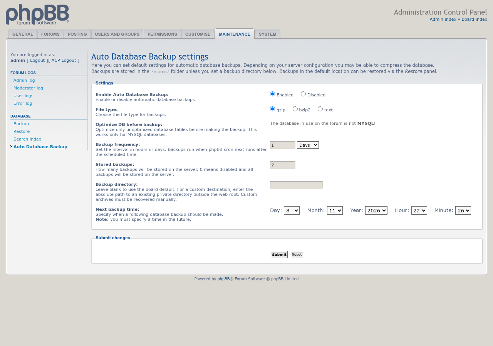
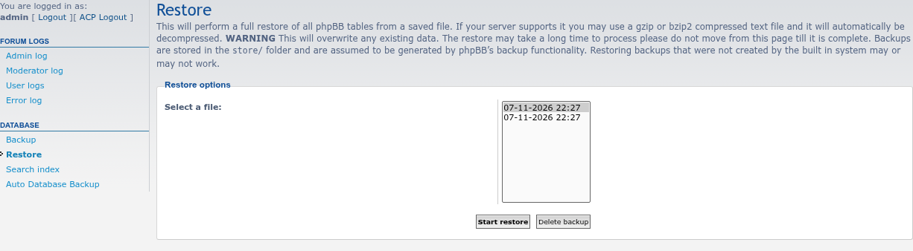

# Auto Database Backup

 

Automatically backs up your database using phpBB cron.

## Features

- Backs up every database table on a schedule, every 1 to 99 hours or days, starting at a date and time you choose.
- Saves backups as plain SQL, gzip or bzip2, depending on what the server supports.
- Keeps only the newest automatic backups, as many as you set. Manual backups and backups from older versions are never deleted.
- Backups appear in **ACP → Maintenance → Restore**, like the ones phpBB makes itself, or go to a private directory outside the web root that you choose.
- On MySQL, can optimize fragmented tables before each backup.

## Screenshots

<table>
<tr>
<td></td>
<td></td>
</tr>
</table>

Click an image for the full size. See the [screenshot gallery](docs/images/screenshots/README.md) for captions.

## Requirements

- phpBB 3.3.19 or later, including phpBB 4.0 (tested on its 4.0.0-a3 development version)
- PHP 8.1 or later

## Installation

1. Copy the extension to `/ext/phpbbmodders/autodbbackup`
2. In the Administration Control Panel, go to **Customise → Manage extensions**
3. Enable the **Auto Database Backup** extension
4. Choose the settings under **ACP → Maintenance → Database → Auto Database Backup**

### Upgrading from `pico/autodbbackup`

This extension used to be installed as `pico/autodbbackup`. Its settings and existing backups carry over:

1. Disable the old **Auto Database Backup** extension in the ACP. Do **not** delete its data.
2. Upload this version to `/ext/phpbbmodders/autodbbackup` and enable it. The old install's migration history and ACP page are moved to the new name automatically.
3. Delete the `/ext/pico/autodbbackup` folder and purge the board cache.

If you disable the old extension from the command line (`bin/phpbbcli.php`) instead of the ACP, run `bin/phpbbcli.php cache:purge` before enabling the new one; the command-line disable doesn't clear the cache.

## Backup retention

The **Stored backups** setting applies to automatic backups made by version 2.2.0 or later, which carry a marker in their file names. Older and manual backups are kept for you to review and remove. `0` keeps every backup.

## Custom backup directory

Leave **Backup directory** blank to keep phpBB's default destination and ACP Restore integration. A custom directory must already exist and be private: writable by the PHP process, closed to other users (for example mode 0700 or 0750), and outside every web document root. Enter its absolute path without symbolic links or a trailing slash.

Changing the setting leaves existing backups where they are. Retention applies only to automatic backups in the selected directory. Backups in a custom directory are not listed in ACP Restore on either phpBB branch; restore one with a database tool. phpBB 3.3 first writes the backup to the board's protected `store/` folder, then the extension moves it to the custom directory.

## Uninstall

1. In the ACP, go to **Customise → Manage extensions** and disable **Auto Database Backup**.
2. To remove its settings too, click **Delete data**, then delete the `/ext/phpbbmodders/autodbbackup` folder. Backup files stay where they are.

## Contributing

Contributions are welcome!

- **Bug reports**: [Open an issue](https://github.com/phpbbmodders/autodbbackup/issues).
- **Everything else** (questions, feature requests, ideas, general discussion): [Use Discussions](https://github.com/orgs/phpbbmodders/discussions), or the [community forum](https://www.phpbbmodders.com/community/).
- Pull requests are welcome for bug fixes or discussed features.

## Acknowledgments

- Original extension by Lukasz Kaczynski (pico), later maintained by Rich McGirr ([RMcGirr83](https://github.com/rmcgirr83)).
- Code review, bug fixes, and documentation assisted by [Claude](https://www.anthropic.com/claude).
- Backup retention, phpBB 4.0 storage and hourly schedules assisted by [Codex](https://openai.com/codex/).

## License

This extension is licensed under the **GNU General Public License v2.0**.

See [license.txt](license.txt) for more information.
