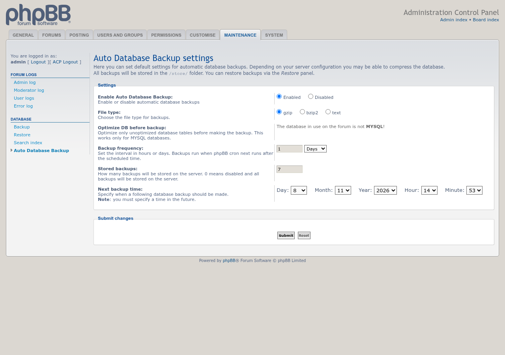
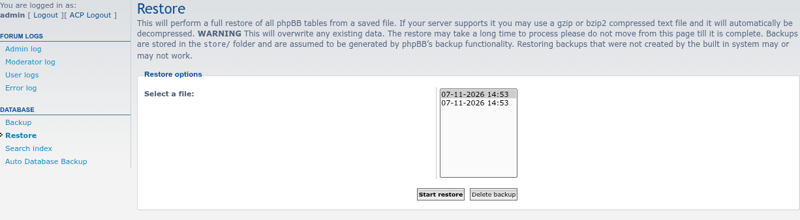

# Auto Database Backup screenshots

Taken on phpBB 3.3.19 with SQLite, so the MySQL-only optimize setting is not offered.

## ACP settings

**ACP → Maintenance → Database → Auto Database Backup**, set to make a gzip backup every day and keep the newest seven.

## ACP Restore

Automatic backups appear in phpBB's own **ACP → Maintenance → Restore** list, next to manual ones.

