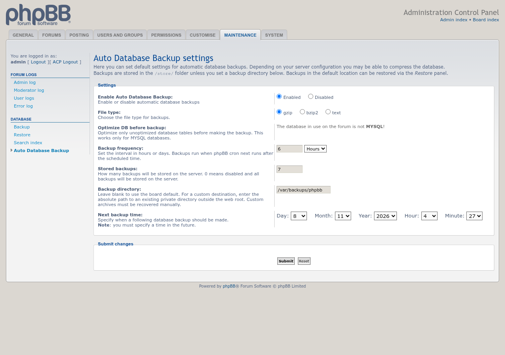
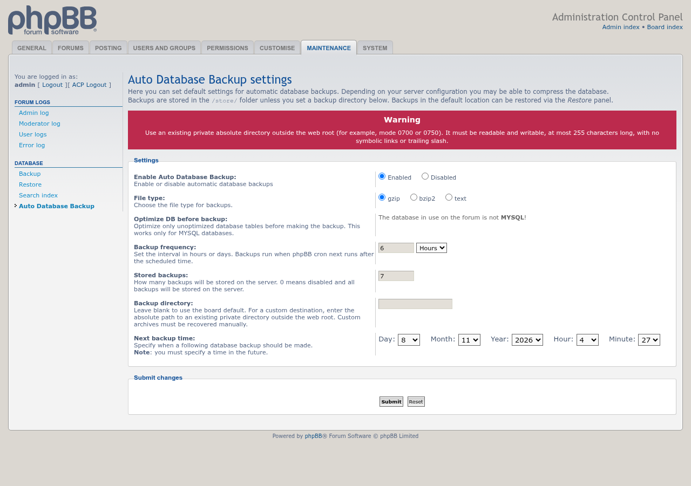

# Auto Database Backup update, 11/07/2026

Screenshots for the 2.2.0-dev development build, taken on phpBB 3.3.19 with phpbb-release-tools' `screenshots.py`. The full set is in the [screenshot gallery](../../images/screenshots/README.md).

## Hourly schedule and custom backup directory

The backup frequency can be set in hours or days, and backups can go to a private directory outside the web root. Here: a backup every 6 hours, kept in `/var/backups/phpbb`.

## Directory checks

The settings page refuses a directory inside the board or web root, open to other users, a symbolic link, or longer than 255 characters.

